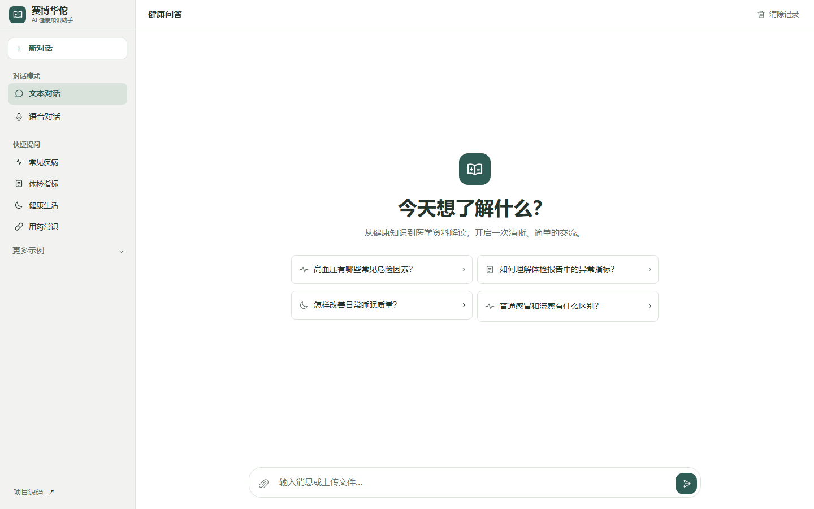
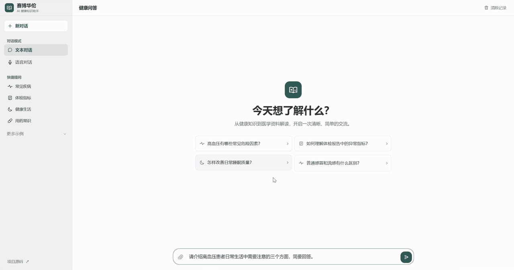
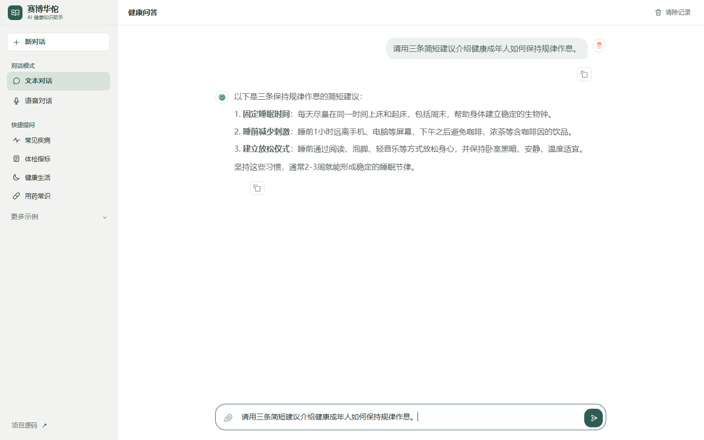
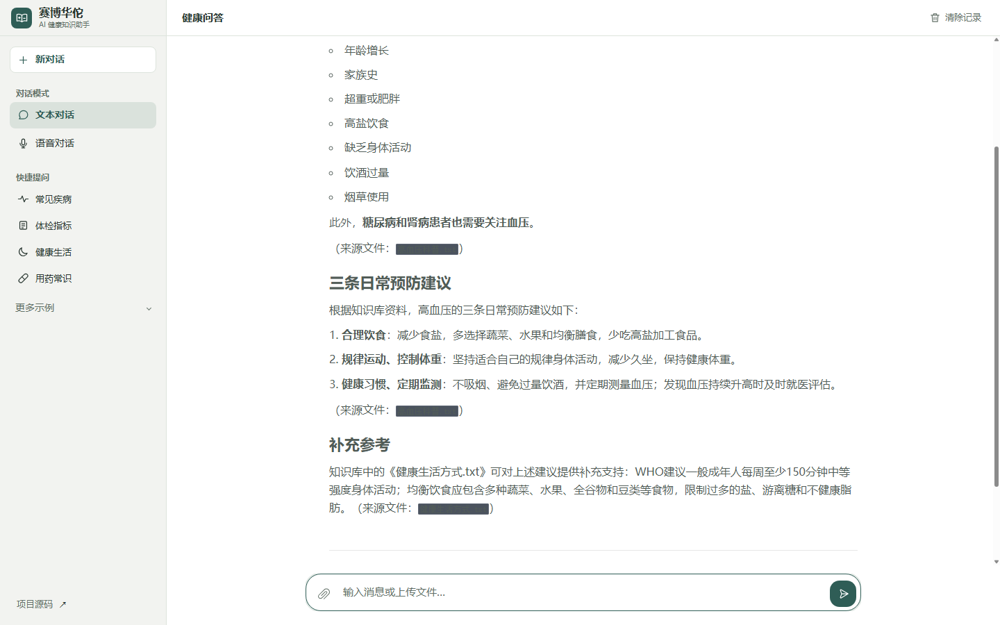
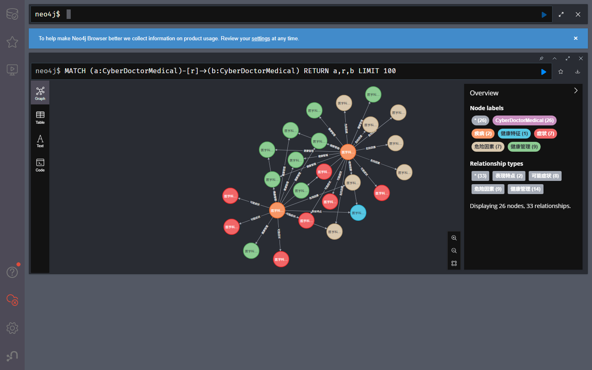
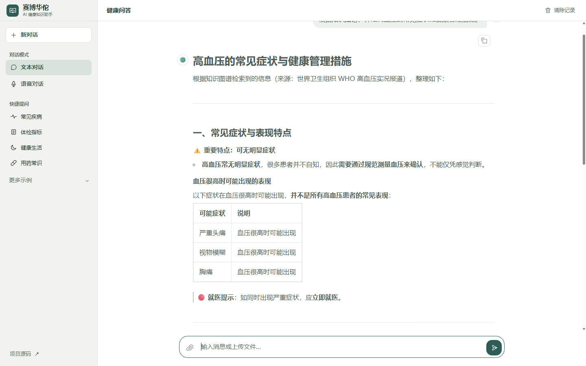
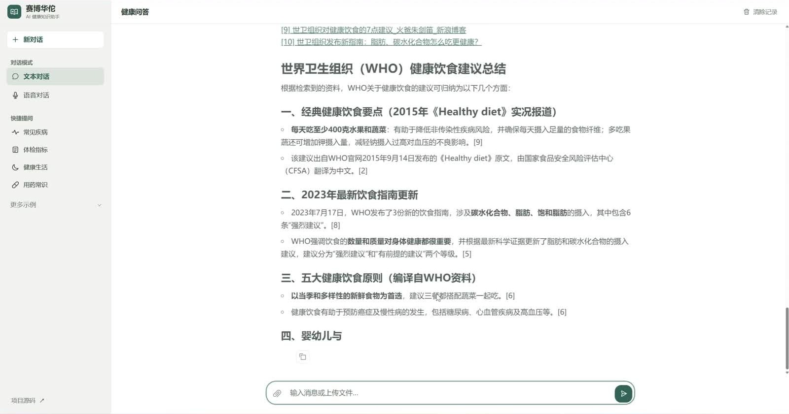
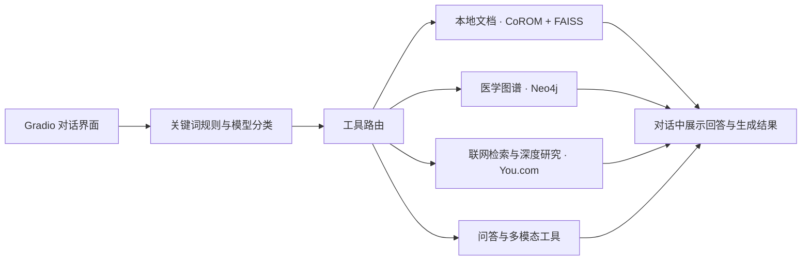

# 赛博华佗 · Cyber Doctor

[English](README_en.md) · [GPL-3.0](LICENSE)

赛博华佗是一个面向健康知识问答和资料解读的开源助手。你可以在同一个界面里输入文字、上传文件或切换到语音模式。系统根据问题调用本地知识库、医学知识图谱、联网搜索或多模态工具，并在对话中展示结果。



## 演示

课程汇报实录（2 分 38 秒）。演示依次展示文本问答、本地知识库检索、Neo4j 图谱查询、联网搜索和健康主题图片生成。



## 功能

| 功能 | 使用方式 |
| --- | --- |
| 文本问答 | 直接输入问题或选择快捷提问。普通问答支持连续追问，文本回答会逐步显示。 |
| 语音对话 | 切换到「语音对话」，录音或上传音频。Whisper 识别语音，文本回答可通过 Edge TTS 生成语音。 |
| 本地知识库 | 以「根据知识库」开头提问。系统用中文向量模型和 FAISS 检索本地文档片段，再根据资料组织回答。 |
| 医学知识图谱 | 以「根据知识图谱」开头提问。系统从 Neo4j 查询疾病及其症状、危险因素或健康管理措施之间的关系。 |
| 联网搜索与深度研究 | 用「搜索」查询公开网页并查看来源链接。用「深度研究」调用 You.com 的研究接口。 |
| 附件与内容生成 | 上传图片、PDF、DOCX 或文本文件后提问。也可以请求生成图片、视频、语音、PPT 或 Word 文档。 |

<details>
<summary>文本问答与知识库示例</summary>





</details>

<details>
<summary>医学知识图谱示例</summary>





</details>

<details>
<summary>联网搜索与图片生成示例</summary>




</details>

## 本地运行

使用 **Python 3.12**。语音识别和音频格式转换还需要将 FFmpeg 加入 `PATH`。

### 1. 下载并安装依赖

```sh
git clone --branch v2 https://github.com/ZeroTang05/cyber-doctor.git
cd cyber-doctor
python -m venv .venv
```

在 Windows PowerShell 中安装依赖并创建配置文件。

```powershell
.\.venv\Scripts\python.exe -m pip install -r requirements.txt
Copy-Item .env.example .env
```

在 macOS 或 Linux 上使用以下命令。

```sh
.venv/bin/python -m pip install -r requirements.txt
cp .env.example .env
```

### 2. 配置模型

**MiniMax**。将 API 密钥设置到系统环境变量 `MINIMAX_API_KEY`，或使用已有的 `api_key_minimax`。在 `.env` 中设置以下两项以启用 MiniMax 文本与图片生成。

```dotenv
LLM_PROVIDER=minimax
IMAGE_PROVIDER=minimax
```

默认文本模型是 `MiniMax-M3.1-Flash`，默认生图模型是 `MiniMax-H3-Image`。可通过 `MINIMAX_MODEL` 和 `MINIMAX_IMAGE_MODEL` 修改。

**OpenAI 兼容接口**。在 `.env` 中填写 `LLM_BASE_URL`、`LLM_API_KEY` 和 `MODEL_NAME`。文本对话通过 OpenAI SDK 调用。智谱图片生成、图片理解和视频生成分别使用各自的密钥与模型配置。 [.env.example](.env.example)

### 3. 启动应用

```powershell
# Windows PowerShell
.\.venv\Scripts\python.exe app.py
```

```sh
# macOS / Linux
.venv/bin/python app.py
```

浏览器打开 [http://127.0.0.1:10032](http://127.0.0.1:10032)。

### 可选功能配置

| 功能 | 需要配置 |
| --- | --- |
| 本地知识库 | 将资料放入 `konwledge-base/`。仓库附带健康生活、高血压和糖尿病科普资料。首次使用会下载中文向量模型并建立 FAISS 索引。知识库读取 PDF 时需在同一 Python 环境安装 `pypdf`。 |
| 医学知识图谱 | 启动 Neo4j，在 `config/config-web.yaml` 中填写连接地址、数据库和用户名，并在 `.env` 设置 `NEO4J_PASSWORD`。用启动应用的同一个 Python 环境运行 `python kg/import_medical_graph.py`，即可导入高血压和糖尿病科普示例。 |
| 联网搜索与深度研究 | 在 `.env` 中填入 `YOUCOM_API_KEY`。 |
| 智谱图片理解与视频生成 | 分别设置 `IMAGE_DESCRIBE_API` 和 `VIDEO_GENERATE_API`，并按需修改对应的模型名称。若使用智谱生图，设置 `IMAGE_GENERATE_API` 和 `IMAGE_GENERATE_MODEL`。 |

## 系统架构

Gradio 接收文字、附件与语音。意图分类先匹配明确的关键词，其余问题交给模型分类，再转发到对应工具。检索结果会作为参考资料传给回答模型。



- [app.py](app.py) 和 [interface.css](interface.css) 实现页面与交互。
- [qa/](qa/) 负责意图分类、工具分发与问答，[client/](client/) 管理模型接口。
- [rag/](rag/)、[kg/](kg/) 和 [Internet/](Internet/) 提供文档检索、图谱查询与联网搜索。

## 贡献与许可

感谢 [YM](https://github.com/YM556)、[L-MARK](https://github.com/L-MARK)、[Goku-30](https://github.com/Goku-30)、[laobaishui](https://github.com/laobaishui) 和其他贡献者。 [完整贡献记录](https://github.com/ZeroTang05/cyber-doctor/graphs/contributors)

项目参考了 [meet-libai](https://github.com/BinNong/meet-libai)，采用 [GPL-3.0](LICENSE) 许可。

<details>
<summary>Star History</summary>

<a href="https://star-history.dera.page/ZeroTang05/cyber-doctor">
  <picture>
    <source media="(prefers-color-scheme: dark)" srcset="https://star-history.dera.page/svg?repos=ZeroTang05/cyber-doctor&theme=dark">
    <source media="(prefers-color-scheme: light)" srcset="https://star-history.dera.page/svg?repos=ZeroTang05/cyber-doctor&theme=light">
    
  </picture>
</a>

</details>
