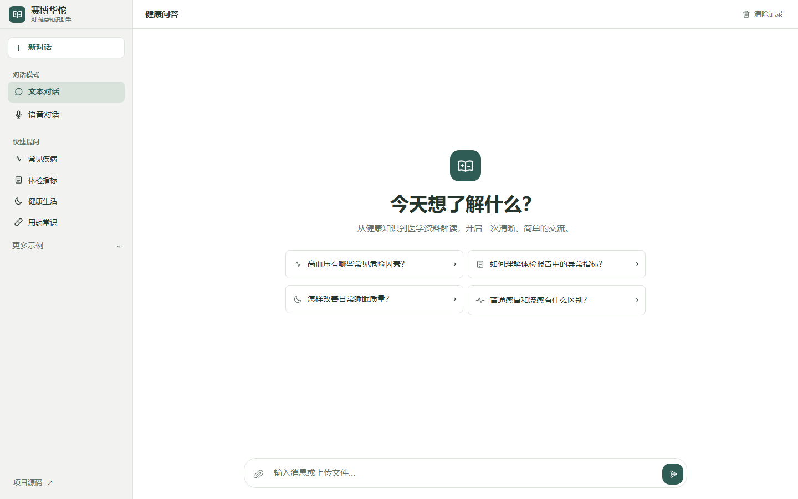
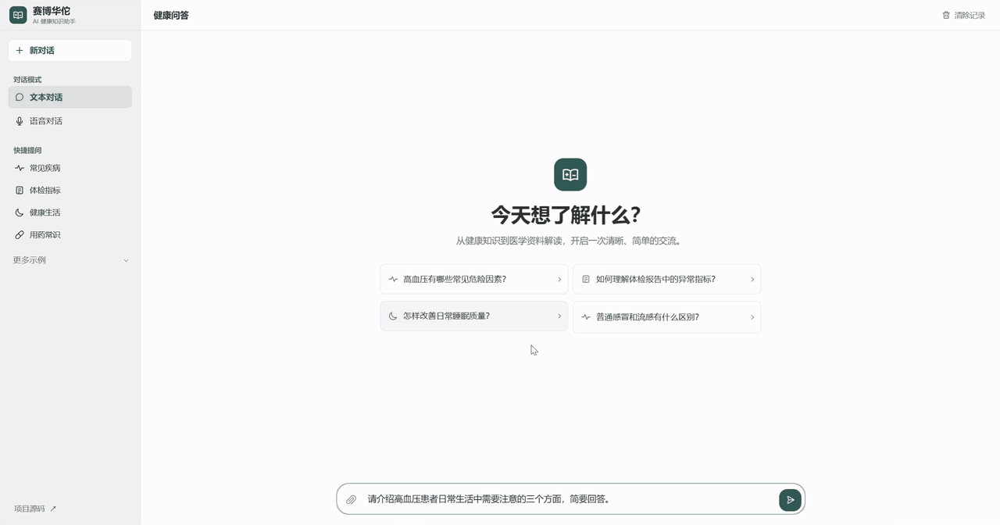
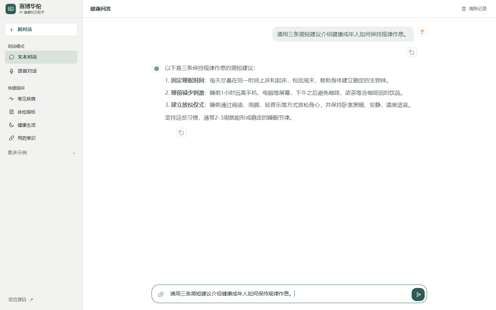
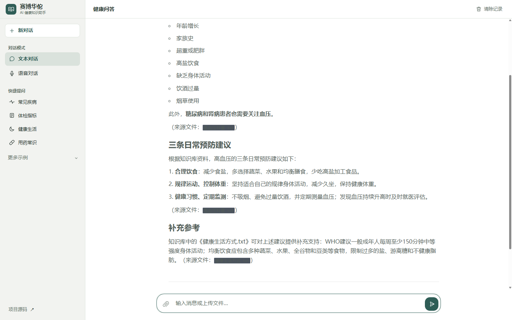
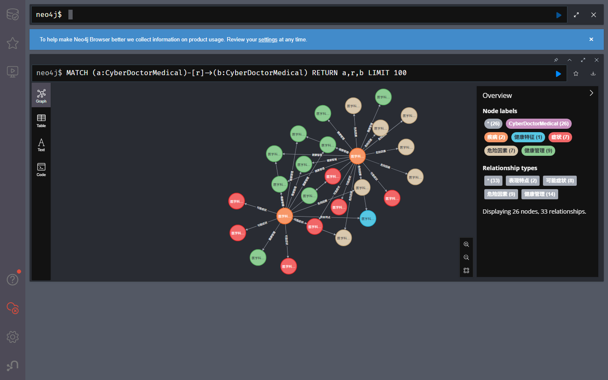
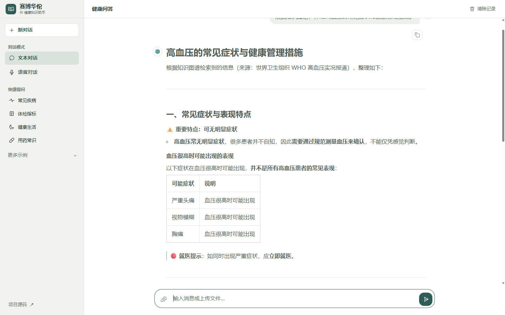
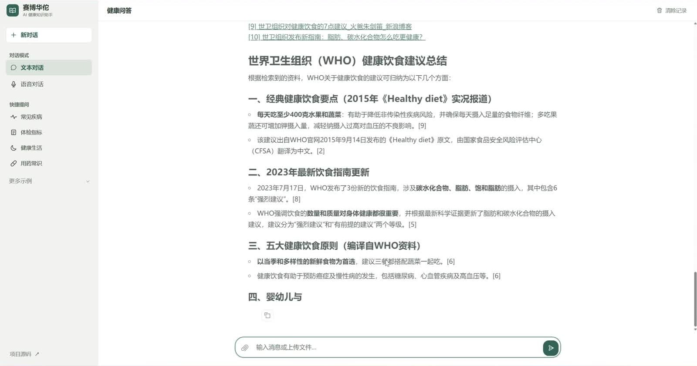
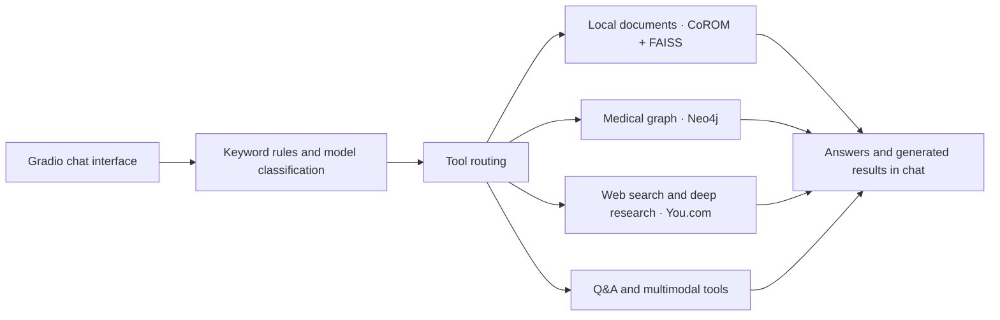

# Cyber Doctor · 赛博华佗

[简体中文](README.md) · [GPL-3.0](LICENSE)

Cyber Doctor is an open-source assistant for health education and document interpretation. You can type a question, attach a file, or switch to voice mode. The app routes each request to the relevant tool, including local document retrieval, a medical knowledge graph, web search, and multimodal generation.



## Demo

The 2-minute, 38-second course demo shows a text conversation, local document retrieval, a Neo4j graph query, web search, and health-themed image generation.



## Features

| Feature | How to use it |
| --- | --- |
| Text conversations | Type a question or select a suggested prompt. You can ask follow-up questions, and text answers appear as they are generated. |
| Voice conversations | Switch to voice mode and record or upload audio. Whisper transcribes speech, and Edge TTS can read answers aloud. |
| Local knowledge base | Start your prompt with `根据知识库` (use the knowledge base). The app uses a Chinese embedding model and FAISS to retrieve relevant passages and ground the answer in those documents. |
| Medical knowledge graph | Start with `根据知识图谱` (use the knowledge graph). Neo4j returns relationships between conditions and their symptoms, risk factors, or management measures. |
| Web search and deep research | Use `搜索` (search) to find public web sources and view their links. Use `深度研究` (deep research) to call the You.com Research API. |
| Attachments and generation | Ask about an attached image, PDF, DOCX, or text file, or request an image, video, audio file, PowerPoint presentation, or Word document. |

<details>
<summary>Text conversation and document retrieval examples</summary>





</details>

<details>
<summary>Medical knowledge graph examples</summary>





</details>

<details>
<summary>Web search and image generation examples</summary>




</details>

## Run locally

Use **Python 3.12**. Audio conversion and speech recognition also require FFmpeg on your `PATH`.

### 1. Clone and install dependencies

```sh
git clone --branch v2 https://github.com/ZeroTang05/cyber-doctor.git
cd cyber-doctor
python -m venv .venv
```

On Windows PowerShell, install the dependencies and create the configuration file.

```powershell
.\.venv\Scripts\python.exe -m pip install -r requirements.txt
Copy-Item .env.example .env
```

On macOS or Linux, use these commands.

```sh
.venv/bin/python -m pip install -r requirements.txt
cp .env.example .env
```

### 2. Configure a model provider

**MiniMax**. Set the API key in your system environment as `MINIMAX_API_KEY` or use the existing `api_key_minimax` variable. Enable MiniMax for text and image generation in `.env`.

```dotenv
LLM_PROVIDER=minimax
IMAGE_PROVIDER=minimax
```

The defaults are `MiniMax-M3.1-Flash` for text and `MiniMax-H3-Image` for images. Set `MINIMAX_MODEL` or `MINIMAX_IMAGE_MODEL` to override them.

**OpenAI-compatible endpoints**. Set `LLM_BASE_URL`, `LLM_API_KEY`, and `MODEL_NAME` in `.env` for text conversations through the OpenAI SDK. Zhipu image generation, image understanding, and video generation use separate keys and model settings. [.env.example](.env.example)

### 3. Start the app

```powershell
# Windows PowerShell
.\.venv\Scripts\python.exe app.py
```

```sh
# macOS / Linux
.venv/bin/python app.py
```

Open [http://127.0.0.1:10032](http://127.0.0.1:10032) in your browser.

### Optional integrations

| Feature | Setup |
| --- | --- |
| Local knowledge base | Add documents to `konwledge-base/`. The repo includes sample documents on healthy living, hypertension, and diabetes. On first use the app downloads a Chinese embedding model and builds a FAISS index. Install `pypdf` in the same Python environment to index PDFs. |
| Medical knowledge graph | Start Neo4j, set the connection URL, database name, and username in `config/config-web.yaml`, and set `NEO4J_PASSWORD` in `.env`. Run `python kg/import_medical_graph.py` in the app's Python environment to import sample data on hypertension and diabetes. |
| Web search and deep research | Set `YOUCOM_API_KEY` in `.env`. |
| Zhipu image understanding and video generation | Set `IMAGE_DESCRIBE_API` and `VIDEO_GENERATE_API` for the features you use. Set `IMAGE_GENERATE_API` and `IMAGE_GENERATE_MODEL` to use Zhipu for image generation. |

## Architecture

Gradio collects text, attachments, and audio. The intent classifier checks for explicit keywords and sends other requests to a language model for classification. The router then calls the relevant tool. Retrieved documents and web results provide context for the answer.



- [app.py](app.py) and [interface.css](interface.css) implement the interface and interactions.
- [qa/](qa/) handles intent classification, tool routing, and Q&A. [client/](client/) manages model access.
- [rag/](rag/), [kg/](kg/), and [Internet/](Internet/) implement document retrieval, graph queries, and web search.

## Contributors and license

Thanks to [YM](https://github.com/YM556), [L-MARK](https://github.com/L-MARK), [Goku-30](https://github.com/Goku-30), [laobaishui](https://github.com/laobaishui), and everyone else who contributed. [Full contributor history](https://github.com/ZeroTang05/cyber-doctor/graphs/contributors)

The project draws on [meet-libai](https://github.com/BinNong/meet-libai) and is licensed under [GPL-3.0](LICENSE).

<details>
<summary>Star History</summary>

<a href="https://star-history.dera.page/ZeroTang05/cyber-doctor">
  <picture>
    <source media="(prefers-color-scheme: dark)" srcset="https://star-history.dera.page/svg?repos=ZeroTang05/cyber-doctor&theme=dark">
    <source media="(prefers-color-scheme: light)" srcset="https://star-history.dera.page/svg?repos=ZeroTang05/cyber-doctor&theme=light">
    
  </picture>
</a>

</details>
